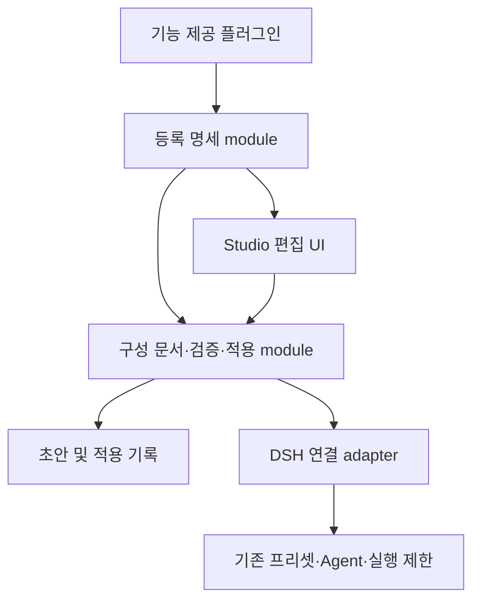

# Studio 워크플로우 구조 검토

## 요약

이 문서는 [기능 명세](workflow-specification.md)를 구현할 때 사용하는 구조 검토와 작업 기준이다. 제품 구현 완료나 검증 결과가 아니다. 등록된 기능의 의미, 구성 문서, 검증·적용의 소유권을 Studio에 두고 실행은 기존 DSH에 맡긴다. 구체적인 서비스 메서드·저장 스키마·패키지 분리는 각 작업에서 실제 소비자를 확인해 결정한다.

## 목차

- [현재 구현과의 차이](#현재-구현과의-차이)
- [책임과 의존 방향](#책임과-의존-방향)
- [검증과 실패 소유권](#검증과-실패-소유권)
- [DSH 연결과 실행 구성](#dsh-연결과-실행-구성)
- [작업 순서](#작업-순서)
- [검증 기준과 남은 결정](#검증-기준과-남은-결정)

## 현재 구현과의 차이

정적 조사에서 확인한 사실이며 이 문서 작성 시 테스트·실제 모델 호출·설치된 GUI 검증은 수행하지 않았다. 제품 요구사항은 [기획서](workflow-product-plan.md)와 기능 명세가 소유하고, 상세 API 조사는 [구성 조사](workflow-composition-research.md)와 [실행 조사](workflow-runtime-research.md)가 소유한다.

| 조사 대상 | 재사용할 동작 | 새 구성 모델로 간주하면 안 되는 부분 |
|---|---|---|
| [General 설정](../packages/general/src/preset-settings.ts) | 선언 복사, 표현식 보존, 리비전 충돌 검사 | raw 플러그인 행의 해시·primitive 필드 목록은 기능 등록 명세가 아님 |
| [역할 설정](../packages/roles/src/roles.ts) | Host 검증, 직렬화된 저장, 저장·활성화 상태, 분리된 자식 설정 캡처 | 구현자·리뷰어 고정 쌍과 현재 설정 조회 |
| [위임](../packages/roles/src/delegation.ts) | executor 제한, scoped 모델 설정, DSH 실행 연결 | 고정 역할·리뷰 통과·재작업 순서를 기본 워크플로우에 강제하는 정책 |
| [자식 실행 adapter](../packages/roles/src/child-runtime.ts) | 공개 DSH 실행·drain 호출의 국소화 | 별도 Studio 실행 엔진으로 확대할 필요 없음 |

[위임 테스트](../test/delegation.browser.test.ts)는 같은 루트에서 Apply 후 새 자식을 만들고 새 지침을 받는 동작을 기대한다. [전체 사이클 테스트](../test/full-cycle.browser.test.ts)의 기존 자식 설정 유지와는 별개다. 새 명세의 실행 전체 구성 고정은 동작과 테스트의 정책을 함께 바꾸어야 한다.

## 책임과 의존 방향

### 등록 명세

컴포넌트·시스템은 명시적으로 등록한다. 안정적 식별자, 버전, 설정 정의, 설명, 적용 범위, 필요한 시스템, 연결 조건, 입출력 의미, 실행 위치와 제한을 제공한다. UI와 적용 판정은 같은 등록 정보를 소비한다. DSH 플러그인 하나와 컴포넌트 하나를 일대일로 가정하거나 모든 설치 플러그인을 자동 변환하지 않는다.

등록은 Cordis 효과의 수명을 따르고 해제 가능해야 한다. 해제 시 새 사용을 막고 UI를 갱신하되 저장한 초안의 미해석 설정은 보존한다. 버전 불일치도 조용히 다른 의미로 읽지 않고 표시한다. 등록 검증은 Host 플러그인 코드의 안전성 인증이 아니다.

### 구성 문서

독립 정의, 워크플로우에 복사한 역할, 실행 Agent를 구분한다. 메인은 역할 참조이며 별도 고정 편집 모델이 아니다. 템플릿과 이름 있는 설정은 독립 복사하고 원본 수정이 복사본에 자동 전파되지 않는다. 임의 역할을 허용하되 범용 ECS·임의 엔티티 언어를 선행 구현하지 않는다.

엔티티는 컴포넌트 설정과 연결·적용 대상을 담고, 시스템은 이를 해석하는 실행 implementation이다. 시스템이 워크플로우 소유라는 의미는 워크플로우마다 별도 프로세스를 만든다는 뜻이 아니다. 공유 플러그인 인스턴스에 실행별 가변 상태를 저장하지 않는다.

### 검증·적용

이 module은 초안 보존, 조합 판정, 지원 확인, 적용 충돌, 결과 기록과 재조회를 소유한다. UI가 검증 순서를 따로 구현하거나 각 기능이 독자적으로 저장·적용 성공을 판단하지 않는다. 저장·적용·활성화·실행은 별개 사실이다.

module의 depth는 복잡한 조합 판정을 작은 interface 뒤에 모으는 데 있다. 삭제하면 검증이 소비자에게 흩어지는 module은 유용하다. 등록 호출만 전달하는 module은 추가하지 않는다. locality는 변경 책임의 집중으로, leverage는 UI·적용·테스트가 같은 의미를 사용하는 것으로 평가한다. 책임 구분이 곧 독립 패키지 분리를 뜻하지는 않는다.

## 검증과 실패 소유권

| 시점 | 판정 소유자와 내용 | 실패 시 보장 |
|---|---|---|
| 등록 | 등록 module: 중복 ID, 정의 모순, 설정·범위·연결 선언 | 모순된 등록 거절. 아직 없는 의존성은 가용성으로 표시 |
| 초안 저장 | 문서 소유자: 형식, 리비전, 저장 안전성 | 불완전 참조·미해석 설정 보존. 실행 가능 판정과 분리 |
| 조합 | 공통 검증: 참조, 필수 시스템, 연결, 충돌, 범위 | 원인 엔티티·필드와 수정 지점을 진단 |
| 의미 | 기능 제공자: 기능별 조건과 조합 의미 | 지원하지 않는 의미를 기본값으로 근사하지 않음 |
| 적용 전 | DSH adapter: 실제 모델, 의존성, 실행 위치, 격리·권한 강제 가능성 | 미지원 구성 적용 거절 |
| 활성화·실행 | DSH 상태 소유자 및 Studio 결과 기록 | 저장/활성화/불명 상태를 구분하고 불명 상태의 무조건 재시도 금지 |

예상 실패는 안정적인 식별자와 처리에 필요한 세부 정보로 전달한다. UI는 현지화된 원인·영향·안전한 다음 행동을 표시한다. 저장 후 활성화 실패를 저장 실패로 축약하거나, 예외를 잡았다는 이유로 원상복구를 보장하지 않는다. 실제 상태 소유자가 안전성을 확인하지 못하면 종속 작업을 중단하고 재조회한다.

파일·설정·도구 JSON·영속 데이터·wire 입력에서는 검증한다. 같은 프로세스의 typed 입력을 이유 없이 반복 검증하지 않는다. UI의 도구 숨김은 실행 제한이 아니며 실제 executor와 자원 접근 지점의 제한이 필요하다.

## DSH 연결과 실행 구성

DSH adapter는 모델·추론·프리셋·Agent 연결과 실제 지원 여부를 국소화한다. Studio 역할 이름과 템플릿 정책을 코어에 넣지 않는다. 현재 개발 범위는 [Studio 작업 범위](../goals.ko.md)에 따라 코어 무수정이다. 공개 확장 지점이 부족하면 제약·대안을 제시하고 별도 범위 승인을 받는다.

장래 코어 확장이 승인되면 [공통 capability seam](../../docs/glossary.md#capability-seam)의 Definition / Provider / Consumer를 함께 설계한다. 두 번째 실행 implementation이 없는 지금 범용 runtime interface, RPC, 스케줄러, 큐, 복구 엔진을 만들지 않는다.

루트 실행 시작에 구성을 고정하고 나중에 생성한 자식도 그 실행의 역할 정의를 사용한다. 새 Apply는 새 루트에 반영한다. 프로세스 내 프리셋 리비전 보유와 재시작 후 과거 코드 복원은 다르다. [프리셋 결정](../../.agents/notes/implemented/architecture/2026-09-18-declarative-agent-presets.md)은 재시작 시 현재 정의에 바인딩하며, [Host 소유권 결정](../../.agents/notes/implemented/architecture/2026-08-10-host-plane-ownership-after-presets.md)은 프로세스 전역 서비스와 Agent 구성을 구분한다. 본 작업은 이를 뒤집거나 과거 실행 코드 복원을 약속하지 않는다.

새 프리셋 선언 생성 경로는 실제 Loader로 확인해야 한다. [ConfigEditor](../../packages/boot/config-editor/src/index.ts)의 기존 Entry 수정이 새 선언 생성까지 지원한다고 추정하지 않는다. 사용자 프로필 직접 덮어쓰기를 우회 경로로 사용하지 않는다.

## 작업 순서

각 작업은 저장·Host·UI·테스트를 포함하는 좁은 수직 단위다. 이 표는 작업 범위 지도이며 진행 상태와 상세 완료 조건은 GitHub 이슈가 소유한다. 번호는 이슈 번호가 아닌 순서다.

| 순서 | 사용자에게 제공할 결과 | 선행 작업 |
|---|---|---|
| 1 | 등록된 지침으로 메인 역할과 초안을 편집·저장·재열기 | 없음 |
| 2 | 연결·필수 시스템 진단과 등록 해제 후 초안 보존 | 1 |
| 3 | DSH 카탈로그 기반 모델·추론 및 임의 역할 편집 | 2 |
| 4 | Studio 소유 프리셋 적용과 실제 모델·지침 확인 | 3 |
| 5 | 실행 구성 고정과 워크플로우 내 자율적 위임 | 4 |
| 6 | 도구 선택을 모델 노출과 실제 실행 제한에 반영 | 5 |
| 7 | 접근 권한·컨텍스트의 지원 범위 표시와 적용 | 6 |
| 8 | 정의·설정 독립 복사와 기본 개발 팀 템플릿 | 7 |

기존 General 편집기와 managed delegation은 공존시킨다. 고정 역할의 영속 기록을 기계적으로 새 엔티티로 바꾸거나 삭제하지 않는다. 명시적 가져오기가 필요하면 별도 데이터 해석과 실패 보장을 정한다. 재사용할 enforcement를 추출하는 prefactor는 해당 기능 작업의 첫 단계로 제한하고 기존 테스트를 유지한다.

## 검증 기준과 남은 결정

각 작업은 자신의 양성·음성 경로를 단위 테스트, 실제 Loader 통합, 변경된 모델·사용자 출력 스냅샷, 해당 UI로 확인한다. 키 없는 replay는 라이브 모델 또는 설치된 앱 검증을 대신하지 않는다. 공통 적합성 테스트는 첫 여섯 기능에 적용하고 외부 SDK로 성급히 분리하지 않는다.

- 등록 중복 거절, 해제·재등록, 미해석 초안 왕복과 UI 갱신.
- 필수 시스템 누락, 잘못된 연결, 범위 충돌과 수정 위치 진단.
- 저장 충돌, 활성화 실패, 응답 유실 후 재조회, 적용 중 기능 제거.
- 같은 프리셋의 두 실행 격리와 효과 해제 후 정리.
- 구 루트의 늦은 자식은 구 구성, 새 루트는 새 구성.
- 숨긴 도구와 Agent 소유 도구의 직접 실행 거부, 허용 경로의 양성 대조.
- 부모·Host 제한 상속과 읽기 전용 의미의 정확성.
- 모델 기본값·추론·컨텍스트 의미가 실제 요청 및 로그와 일치.

실제 공개 API 확인 전 확정하지 않을 항목은 새 프리셋 생성 소유권, 실행 구성 고정의 저장 위치, 독립 자식 권한 범위, 컨텍스트 옵션 의미, 지침 섹션 지원이다. 구현자가 지원 공백을 발견하면 해당 동작을 완성으로 표시하지 않고 관련 작업을 중단해 범위 결정을 요청한다. 제품 수용 기준과의 대응은 [기능 명세](workflow-specification.md)의 A1–A12를 사용한다.
