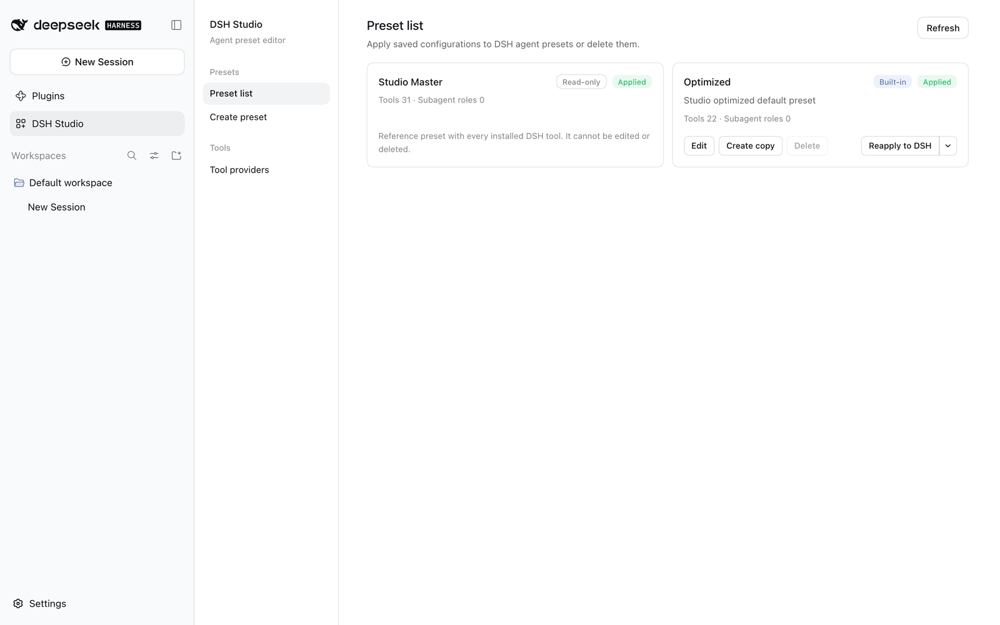
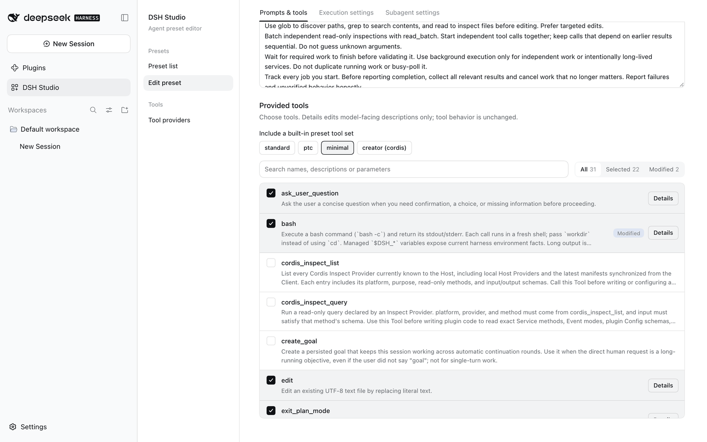
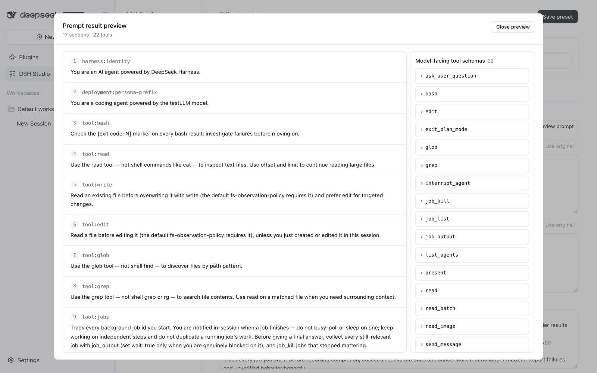
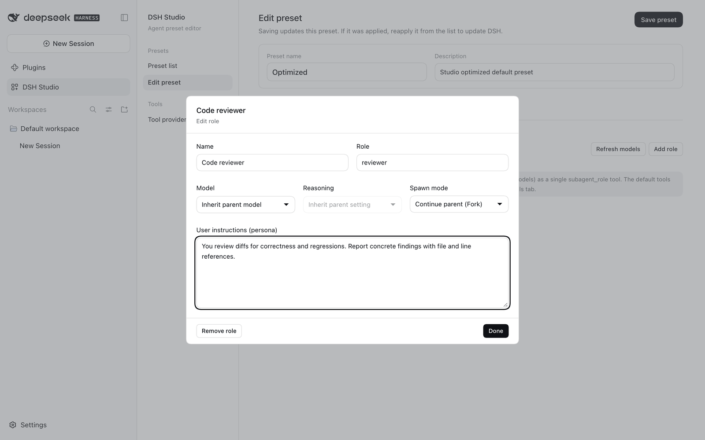

# DSH Studio

A [DeepSeek Harness](https://github.com/deepseek-ai/deepseek-harness) plugin for building agent presets in the web GUI: choose tools, edit prompts and tool descriptions, override plugin Configs, define role-based subagents, preview the assembled system prompt, and apply the result as a DSH agent preset.

## Install

Requires DSH `0.2.0-rc.2` or `0.2.1-alpha.2`.

```sh
dsh plugin --profile web add @matamt-dbg/dsh-studio
```

Restart the web GUI, then open **DSH Studio** from the sidebar.

## Features



- **Presets** — a read-only *Studio Master* with every available tool, a built-in *Optimized* preset (22 everyday tools), and your own presets. Edit, copy, delete, apply to DSH, or unapply.
- **Prompts & tools** — edit persona and additional instructions, pick tools (or whole built-in tool sets), and rewrite the descriptions the model sees for each tool and parameter.
- **Prompt preview** — see the exact system prompt and tool schemas a preset produces, without starting an agent.
- **Execution settings** — override plugin configuration for one preset only.
- **Subagents** — DSH's generic subagent tools become a single `subagent_role` tool. Define roles with their own model, reasoning effort, fresh or fork start, and persona; with no roles, `subagent_role` starts a child that inherits the parent's settings.

| Prompts & tools | Prompt preview | Subagent roles |
|---|---|---|
|  |  |  |

**[Read the user guide →](docs/guide.md)**

## Quick start

1. Open **DSH Studio** and select **Edit** (or **Create copy**) on *Optimized*.
2. Adjust instructions, tools, execution settings and subagent roles, then **Save preset**.
3. In **Preset list**, select **Apply to DSH**.
4. Start a new session and choose your preset in DSH's preset picker.

Presets are stored per profile in `studio-data/`. Applying a preset registers a Studio-owned DSH agent preset; it never edits other presets or the profile's packages.

## Development

```sh
pnpm install
pnpm test        # typecheck, build, tests
node pack.mjs    # writes dist/matamt-dbg-dsh-studio-<version>.tgz
```

Please report bugs and requests in [Issues](https://github.com/matamt-dbg/dsh-studio/issues).

## License

MIT
